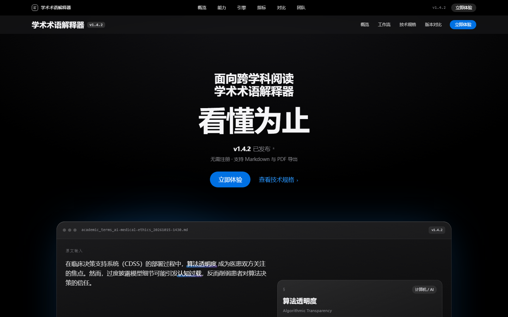
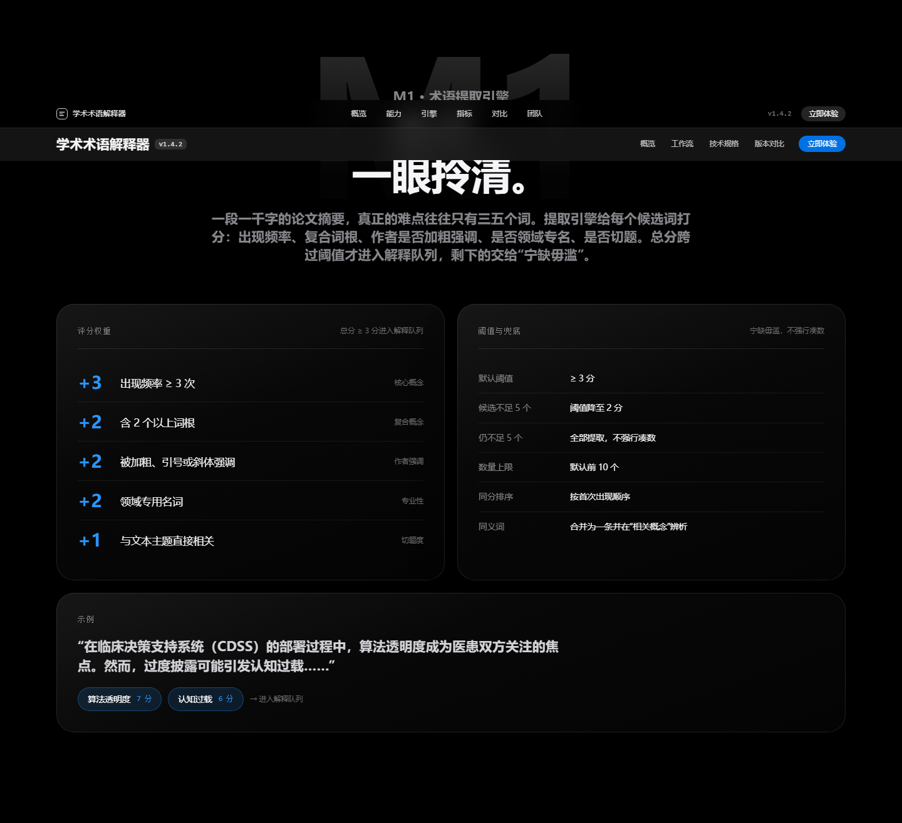
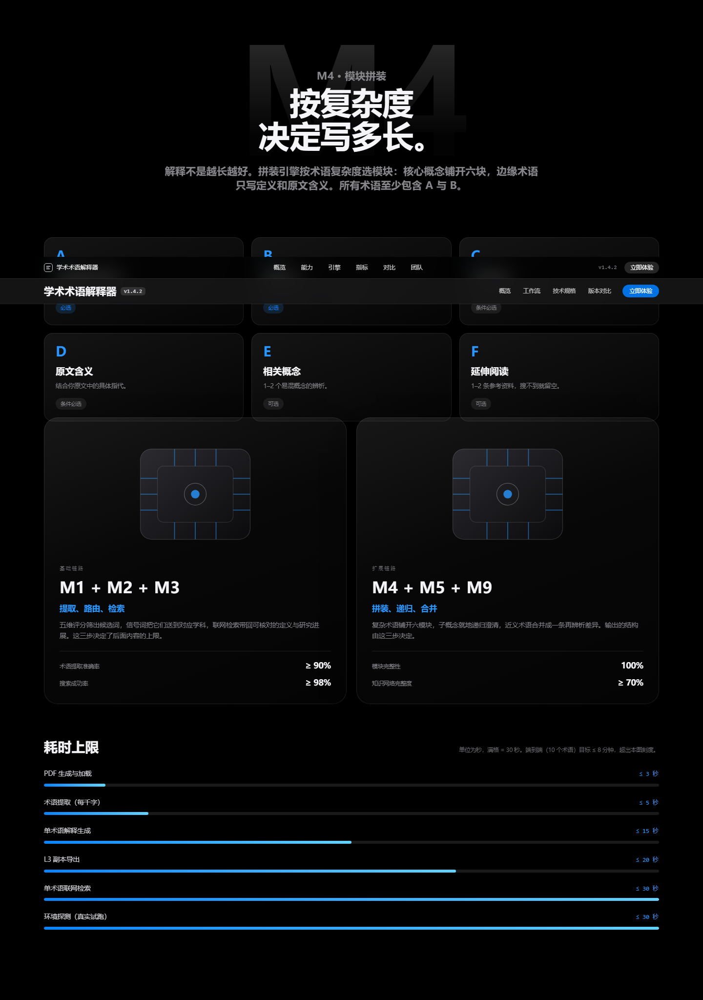

# 学术术语解释器 · 产品介绍网页

> 参赛作品「学术术语解释器（Academic Term Explainer）」的产品官网，由 **下次一定队** 制作。
> 版式、布局、字号、间距、滚动节奏参照 Apple 产品页（`/macbook-pro/proled-xdr-display/`）的公开排版规范，文案全部替换为本产品内容。

技术栈：**Vue 3 + TypeScript + Vite + GSAP（ScrollTrigger）**

## 页面预览

| 首屏 | 引擎区块 | 模块拼装与耗时基准 |
| --- | --- | --- |
|  |  |  |

---

## 快速开始

```bash
pnpm install     # 安装依赖
pnpm dev         # 本地开发：http://127.0.0.1:5273/
pnpm build       # 类型检查 + 生产构建，产物在 dist/
pnpm preview     # 预览构建产物
```

构建产物是纯静态文件，`dist/` 可直接放到任意静态服务器；`vite.config.ts` 中 `base: './'`，因此也支持以 `file://` 或子路径部署。

### 开发期截图校对（可选）

```bash
node scripts/shot.mjs http://127.0.0.1:5273/ .shots/page.png 1440 full
node scripts/shot.mjs http://127.0.0.1:5273/ .shots/sec.png 1440 "scrollto:#extraction" -60
node scripts/shots-sections.mjs http://127.0.0.1:5273/ 1440 .shots/sections
```

依赖 `playwright`（devDependency，仅用于截图，不进入运行时）。

---

## 目录结构

```
web/
├── index.html                 页面外壳、SEO 描述、lang=zh-CN
├── vite.config.ts             端口 5273；Windows 下用轮询监听规避临时文件 EBUSY
├── scripts/                   截图脚本、按步骤提交脚本
├── PLAN.md                    实施规划：设计规范实测值 + 章节映射 + 步骤清单
└── src/
    ├── main.ts                入口，按顺序引入三份全局样式
    ├── App.vue                页面装配顺序（等于参考页的 section 顺序）
    ├── styles/
    │   ├── tokens.css         设计令牌：内容宽度、断点、字号阶梯、配色、圆角、缓动
    │   ├── base.css           reset、字体栈、字号阶梯 .type-*、主题上下文、无障碍
    │   └── utilities.css      布局工具类：.section / .viewport-content / .section-header / 胶囊按钮 / 玻璃卡片
    ├── data/content.ts        全站文案与指标（唯一内容源，便于逐字校对）
    ├── composables/
    │   ├── useSiteMotion.ts   站点级动效：成组淡入、视差、条形图增长、数字滚动
    │   └── useSceneProgress.ts 粘性场景的滚动进度组合式函数
    └── components/
        ├── layout/            LocalNav · SiteFooter（脚注 + 页脚）
        ├── ui/                TypeLockup · SectionHeader · StorySection
        └── sections/          Hero · Highlights · Design · Extraction · Routing · Search
                               Assembly · Recursion · Reliability · Workflows · Metrics
                               Interfaces · Trust · Upgrade · Team · Values · Index
```

---

## 设计还原对照

参考页共 19 个 section，本站按同一节奏排布（见 `PLAN.md` 第二节完整映射表）：

| 参考页 | 本站 | 还原要点 |
| --- | --- | --- |
| Local nav | 页面导航 | 52px、`backdrop-filter` 毛玻璃、滚动后加深；进入浅色区块时切换浅色主题（全局导航按需求移除） |
| Media hero | Hero | 32px 眉标两行 + 80px 主标题 + 发售信息 + 价格 + 胶囊按钮 + 全宽产品视窗 |
| Highlights | 先刷重点 | 区块头（左标题 / 右链接）+ 横向卡片画廊 + 圆形翻页按钮 |
| Product viewer | 设计 | 左粘性视窗 + 右滚动文案，视窗内容随滚动切换（输入 → 处理 → 输出） |
| Display / Touch / Island / Performance / AI / Battery | M1–M6 引擎区块 | 巨型水印数字（M1…M6）+ 居中 type-lockup + 卡片化正文 |
| Workflows | 专业场景 | 胶囊 Tab 切换 + 双栏面板 |
| Audio & camera | 技术指标 | 大号数字网格（48–56px） |
| Ports | 学科接口 | 端口式卡片 + 17 学科芯片墙 |
| Security | 可信性 | 左侧粘性文案 + 右侧编号列表 |
| Upgrader | 版本对比 | 浅色区块 + 三列对比表（当前版本列高亮） |
| Incentive | 参赛信息 | 8 张 284px 圆角卡片 |
| Values | 价值观 | 3 张卡片 + 箭头链接 |
| Index | 结尾 | 居中大标题 + 四列索引 + 巨型浅色字标 |
| Footnote + Footer | 脚注 + 页脚 | 12px 灰色脚注、三列页脚、版权行 |

### 关键数值（取自参考页 CSS 实测）

- 内容宽度 `87.5%` / 最大 `1260px`；断点 1069 / 735 / 734
- 区块上下留白 `144 / 120 / 112px`
- 字号阶梯：hero 80·64·40 / 区块标题 48·40·32 / type-lockup 64·48·40 / 眉标 32·28·24 / 导语 21·21·19 / 正文 17 / 脚注 12
- 深色 `#000`、浅色 `#f5f5f7`、正文 `#f5f5f7` / `#86868b`、链接 `#2997ff` / `#0066cc`、按钮 `#0071e3`
- 圆角：卡片 28px、小卡片 18px、胶囊 980px

---

## 动效

入场动效由 **GSAP + IntersectionObserver** 驱动，通过 `data-*` 声明，逻辑集中在 `useSiteMotion.ts`：

- `data-stagger` / `data-stagger-item`：成组淡入上移（0.9s，stagger 0.075s，触发一次）
- `data-reveal`：单元素淡入
- `data-bar`：条形图 `scaleX` 增长（宽度由模板写入 `--bar-width`，动画只负责从 0 展开）
- `data-count`：数字滚动计数
- Hero 场景、能力卡片、设计区块：各自用 GSAP 时间轴（入场、常驻自转/扫描、悬停插值）

> 入场没有用 ScrollTrigger：它在 `refresh()`（load / resize）时会重置尚未播完的 `from` 动画，导致卡片网格停在半路、条形图停在起点。IntersectionObserver 是单向触发，不受刷新影响。

无障碍与降级：默认播放完整动效（本页动画本身即内容的一部分）；`<html>` 上挂 `reduced-motion` 类时，GSAP 与 CSS 过渡全部退化为极短淡入，不再有位移，页脚的 **「动效：完整 / 精简」** 开关可随时切换并写入 `localStorage`。每个交互控件都有 `aria-label` / `aria-selected` / `aria-pressed`，横向画廊可用键盘聚焦并滚动，翻页按钮在首尾自动禁用。

---

## 内容来源

- 文案与指标来自《学术术语解释器 · 产品技术文档 v2.0》与《作品演示2.pptx》
- 所有数字均为文档中定义的**目标值**（FI / PI / QI 编号），非实测结果，页脚已注明
- 页面不含 Apple 商标、产品图或文案；版式参考仅用于竞赛展示
- 本项目**未开源**，页面也不作任何开源或免费分发的表述

---

## 已知取舍

1. **字体**：参考页使用系统字体 SF Pro / PingFang SC。本站沿用同样字体栈，在 macOS 上即为原字体；Windows 回退到 Microsoft YaHei UI，字宽略有差异但字号与字重完全一致。
2. **图片资源**：作品素材只有四张浅色主题的架构图，与深色版式冲突，因此所有可视化（产品视窗、能力卡片图形、评分卡、歧义消解、搜索阶梯、递归树、降级链、基准条形图）均以 HTML/CSS/SVG 重绘，未使用位图。
3. **购物流程**：导航与按钮指向页内锚点，不涉及真实下单/支付。

---

## 提交记录

按实现步骤分多次提交，格式 `feat:` / `fix:` / `docs:`。完整历史见：

```bash
git log --oneline
```
